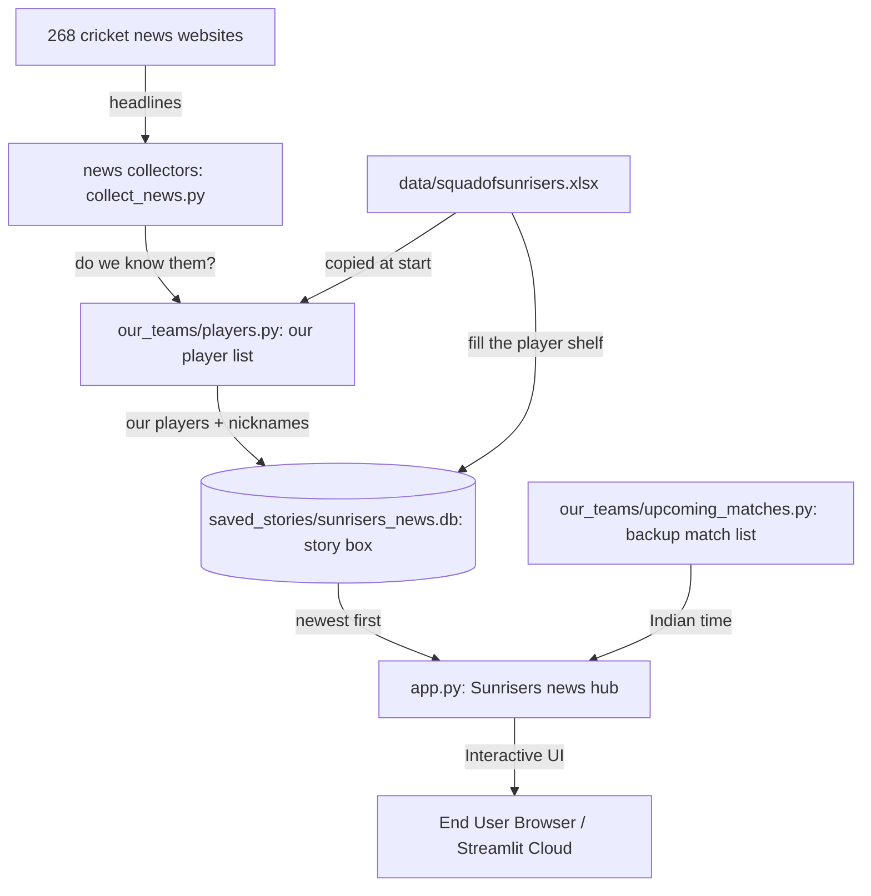

# 🏗️ How the Sunrisers news hub fits together (plain words)

This is the friendly companion to ARCHITECTURE.md. Same building, just with the doors open: where news comes in, how we keep only our players, where stories sleep, and what you see.

---

## 1. High-Level System Architecture



---

## 2. Core Subsystems

### A. Our player list (`our_teams/players.py`)
- **Player list**: our teams live in `data/squadofsunrisers.xlsx` (backup copy at the top level).
- **Strict Word-Boundary Matching**: Uses `r'\b' + re.escape(name) + r'\b'` to ensure surnames (e.g. *Hussain*) never trigger false positives for players with identical last names (*Sakib Hussain*).
- **Disambiguation & Aliases**: Dedicated alias dictionary for single-name headlines (`Klaasen`, `Cummins`, `Head`, `Stubbs`), multi-spelling names (`Dilshan Madhushanka`), and nicknames (`Mitch Marsh`, `Matty Revis`).
- **False-Positive Guardrails**: Blocks non-cricket American sports articles (`padres trade`, `cooper kupp`, `nfl`, `mlb`).

### B. News checker (`news_collectors/collect_news.py`)

- **Website visits**: every site in `NEWS_WEBSITES` is visited with a retry; a down site falls back to a Google News search.
- **Fresh only**: stories older than 24 hours are recycled right away.
- **No per-article scoring**: matched articles are stored with database defaults (`importance_score=5.0`, `category='General News'`).
- **Little notes**: one friendly note per saved story + player.

### C. Story box (`saved_stories/story_storage.py`)
- **A small filing box**: one SQLite file, opened and closed tidily every time.
- **Skipping copies (one copy per player)**:
  ```sql
  CREATE UNIQUE INDEX idx_news_link_target ON news (link, player_name, franchise) WHERE link IS NOT NULL;
  CREATE UNIQUE INDEX idx_news_title_target ON news (title, player_name, franchise);
  ```
  In plain words: one story about two players is filed under both names, but never twice under the same name.
- **Newest first**: each story carries its exact moment as a number, so sorting is simple.
- **Tidying**: stories older than 24 hours are recycled (`throw_away_old_stories()`).

---

## 3. UI Presentation Layer (`app.py` & `our_teams/website_look.py`)

- **Look**: warm daylight colours with big readable type.
- **3 friendly tabs**:
  1. **📡 Latest news**: big top story, story cards, little timeline.
  2. **📋 Matches**: live match list → playing squads checked against our players; live first, finished gone; links and TV guides.
  3. **👥 Our squads**: every player card, team by team, with role, country flag, coach and captain marks.
