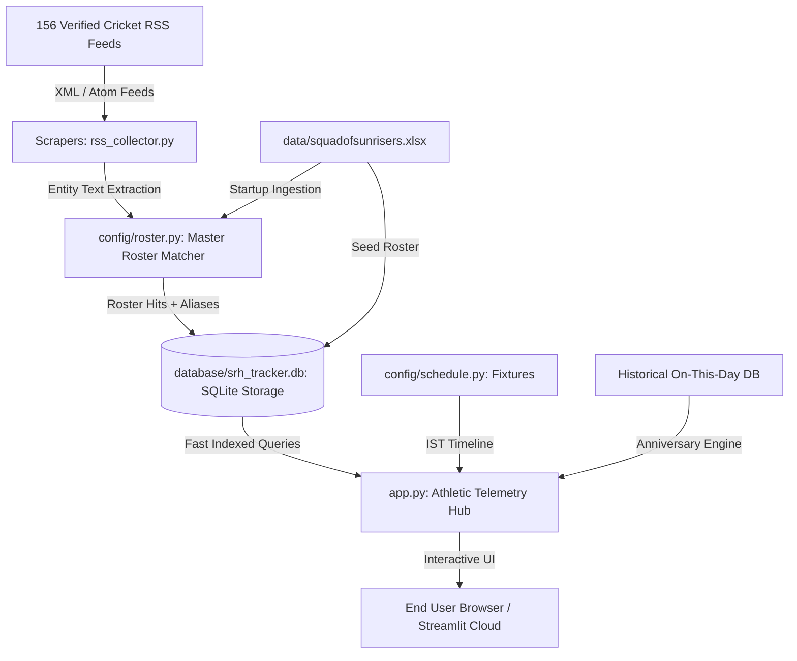

# 🏗️ SRHXtra Architecture & Engineering Specifications

This document outlines the architectural blueprints, data pipelines, ranking algorithms, and storage mechanisms powering the **@SRHXtra** intelligence platform.

---

## 1. High-Level System Architecture



---

## 2. Core Subsystems

### A. Dynamic Roster & Entity Extraction (`config/roster.py`)
- **Master Excel Source**: Loads active franchise players from `data/squadofsunrisers.xlsx` (with fallback to root).
- **Strict Word-Boundary Matching**: Uses `r'\b' + re.escape(name) + r'\b'` to ensure surnames (e.g. *Hussain*) never trigger false positives for players with identical last names (*Sakib Hussain*).
- **Disambiguation & Aliases**: Dedicated alias dictionary for single-name headlines (`Klaasen`, `Cummins`, `Head`, `Stubbs`), multi-spelling names (`Dilshan Madhushanka`), and nicknames (`Mitch Marsh`, `Matty Revis`).
- **False-Positive Guardrails**: Blocks non-cricket American sports articles (`padres trade`, `cooper kupp`, `nfl`, `mlb`).

### B. Ingestion Engine (`scrapers/rss_collector.py`)

- **Feed polling**: all `CRICKET_SOURCES` entries fetched with retry; dead feeds fall back to a Google News mirror.
- **24-hour filter**: articles older than 24h are discarded at ingest.
- **No per-article scoring**: matched articles are stored with database defaults (`importance_score=5.0`, `category='General News'`).
- **Notifications**: one `INFO` notification per stored article-target pair.

### C. Persistent Storage Layer (`database/db_manager.py`)
- **SQLite with WAL Mode & Context Managers**: Safe concurrent reads/writes with zero connection leaks.
- **Target-Aware Deduplication**:
  ```sql
  CREATE UNIQUE INDEX idx_news_link_target ON news (link, player_name, franchise) WHERE link IS NOT NULL;
  CREATE UNIQUE INDEX idx_news_title_target ON news (title, player_name, franchise);
  ```
  *Key Innovation*: If a single article mentions multiple players (e.g. *Travis Head and Heinrich Klaasen*), it is stored once for each tracked player without link collision.
- **Numeric Epoch Ordering**: `pub_timestamp REAL` stores floating-point UNIX epoch seconds, eliminating string-sorting anomalies.
- **Auto-Pruning**: Periodic purging of expired news older than 24 hours (`purge_expired_24h_news()`).

---

## 3. UI Presentation Layer (`app.py` & `config/theme.py`)

- **Design Philosophy**: Daylight Athletic Telemetry (#F8FAFC, #0F172A, #F26522) with Inter typography.
- **4 Dedicated Telemetry Panels**:
  1. **📡 Real-Time Intelligence & News Feed**: Live hero cards, search query filters, pulse timeline.
  2. **📋 Match Day Fixture Breakdown**: Dynamic status detection (`LIVE`, `UPCOMING`, `COMPLETED`), countdown clocks, TV/streaming broadcast tags.
  3. **🗓️ On This Day Historical Engine**: Interactive date picker time machine, match scorecards, records broken.
  4. **👥 Official Squad Directory**: Complete franchise-by-franchise roster cards with role chips, overseas flags, coach leadership, and captain markers.
